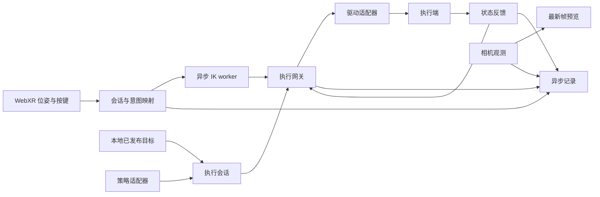

# robot-scratch 架构

## 目标与实现边界

框架复用机器人实验中的连接、输入映射、执行、记录和回放流程，使用户集中于
任务与智能设计。执行端、意图源和观测源按能力组合，不做互斥的设备继承树。

现有 fake 闭环、双臂 WebXR/采集实现、native 回放和假模型路径见
[项目状态](project-status.md)。图是声明与预检的基础；目前只有明确实现的
运行时绑定，不能将配置模板视为任意图解释器或跨形态模型适配器。

## 数据与控制图

- **意图源**输出明确的动作语义；手柄位姿、关节目标和模型 chunk 不是同一种数据。
- **映射/IK**负责显式坐标与模型转换，不持有硬件写入能力。
- **执行会话/网关**检查所有权、代次、时间、新鲜度及设备关节约束。
- **驱动适配器**处理 SDK/ROS/系统协议，不能反向决定任务流程或绕过网关。
- **记录器**保存意图、发布命令、receipt、反馈、图像和事件，区分请求、发布与执行。
- **预览**只消费最新帧；画面展示频率不决定原始记录频率。

用户应用不得向 SDK 直接发送动作。fake 契约、native 工作流与 live 会话各自有
版本边界；协议与原始字段名保留历史命名，以保证已有文件和部署可读。

## 模块分层

| 层 | 主要模块 | 职责 |
| --- | --- | --- |
| 契约与预检 | contracts、graph、collection、experiment_graph | 数据/图声明、类型与配置验证 |
| 应用入口 | cli、deployment、session_launcher、workflow_runner | 解析参数、依赖预检、进程生命周期 |
| 会话与执行 | runtime、collection_runtime、teleop_session、workflow、live_control | 状态机、所有权、接管、失效与唯一写入 |
| 运动转换 | kinematics、pinocchio_model、solver_worker | FK/IK、模型校验、过时结果淘汰 |
| 外部适配 | adapters、control_socket、control_webrtc、webxr_input | ROS/SDK/CAN、网络与输入验证 |
| 观测与预览 | observations、camera_ingress、preview、camera_config | 帧接收、角色与分支配置、按需预览 |
| 记录与消费 | real_episode、episode_store、image_storage、episode_reader、training_view、trajectory | 事务、时间索引、读取、训练视图与回放 |

具体文件导航见[目录职责](repository-layout.md)。现有模块名保持兼容；有明确独立
职责的新模块才增加目录层级，避免只为了目录数量移动公共导入路径。

## 并发与状态归属

HTTP/WebRTC 收到输入不意味着立即运动。网络线程只做校验、入队或调用会话入口；
控制线程驱动状态机。IK 在独立进程中处理最新目标，结果携带代次与时间；
暂停、接管或退出后，迟到结果不能恢复运动。

相机回调向原始记录队列和最新帧预览槽分别交付数据。预览编码独立执行，
不能将预览丢帧策略套到采集。episode 的有界队列由磁盘线程消费；停止采集先
关闭接收窗口，再排空已有队列、关闭编码器/MCAP、生成 QC，最后进入待审阅。
保存/丢弃是显式用户决策，不能把未完成记录标成正常成功。

WSS 运行在独立监听线程；可选 WebRTC 使用独立事件循环和有界输入队列，
应用调用在单 worker 中顺序执行。WebRTC 是否走 UDP 由实际 ICE 路径决定；
协议选择不能消除无线网卡掉线、编码/解码和设备驱动延迟。

## 配置与契约

配置必须明确设备身份、角色、关节顺序、单位、frame、变换、动作空间、数据路径
及依赖环境。硬件驱动与通用核心分离，可选依赖延迟导入；导入核心不连接设备。
模板中的占位符应在本地 profile 替换，不能静默猜测缺失标定或更换机器人模型。

破坏兼容的契约变更需升级版本、说明旧读者行为并提供迁移策略。原始设备时间、
主机接收时间和 MP4 帧时间各自保留；未知时钟或 frame 标为未知。
详细含义见[数据格式](data-format.md)。

## 推理的下一步

真实模型服务器作为可替换意图源，显式转换观测与输出动作，复用执行网关和
设备反馈。需要单独验证动作维度/单位、关节/末端转换、夹爪语义、chunk 调度、
过期结果、接管和端到端任务表现。假模型通过不等于真实策略验证通过。
